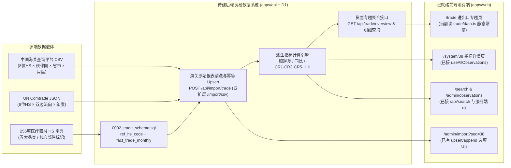

# 阶段交接文档（Handoff）：前端收官 → 后端进出口贸易数据系统开发

- **交接时间**：2026-11-21
- **当前仓库与基线分支**：`mdes-platform` · `ui/itei-refactor`（已合并 [PR #2](https://github.com/scstriker/mdes-platform/pull/2) `feat/thinktank-statista-subpages`）
- **下一阶段唯一聚焦目标**：**医疗器械进出口贸易后端数据系统**（对应《指标体系 V3.0》序号 `38` 及底层 V12 `TRD` 指标簇）

---

## 一、当前工程基线与本地部署状态

### 1. 已完成的门户与后台基线
- **门户架构**：前台公开门户（首页 `/`、独立搜索页 `/search`、注册与产品 `/products`、企业与机构 `/enterprises`、进出口贸易 `/trade`、政策与报告 `/reports`、指标目录 `/system` 及详情 `/system/:seq`）与数据治理后台（`/admin`、`/admin/import`、`/admin/batches`、`/admin/indicators`、`/admin/observations`）已完成双壳分层。
- **检索与可视化**：前后端已统一 `@mdes/shared` 多词项分词与地域/维度中文别名解析，上线 `GET /api/observations?q=...` 与 `GET /api/search`；`StatistaFigure` 支持非完整年虚线标注、原地数据表切换与完整出版物图卡 SVG/CSV 导出。
- **自动化测试门禁**：
  - `npm test`：**96 / 96 通过**（`@mdes/shared` 16、`@mdes/api` 31〔Miniflare `workerd` + 本地 D1〕、`@mdes/web` 49）
  - `npm run build` & `npm run build:demo -w @mdes/web`：零错误通过
  - `npm run e2e`：**108 / 108 通过**（含 80 项 WCAG 2.1 AA 无障碍扫描及 `06-review-regressions.spec.ts`）

### 2. 本地运行地址与运维命令
- **本地前端（Vite + `/api` 代理）**：`http://127.0.0.1:5173`（重点页面：`http://127.0.0.1:5173/trade`、`http://127.0.0.1:5173/system/38`、`http://127.0.0.1:5173/admin/import?seq=38`）
- **本地后端（Wrangler Worker + 本地 D1）**：`http://127.0.0.1:8787/api/health`（本地 SQLite 状态目录：`apps/api/.wrangler/state`）
- **离线单文件演示包**：`apps/web/dist-demo/mdes-demo.html`
- **常用重启/重置命令**（均在 `mdes-platform/` 目录下执行）：
  ```bash
  npm run db:migrate   # 执行 apps/api/migrations/*.sql 到本地 D1
  npm run seed         # 幂等灌入 7 簇 99 项工程指标元数据
  npm run dev:api      # 启动 127.0.0.1:8787
  npm run dev:web      # 启动 127.0.0.1:5173
  ```

---

## 二、进出口贸易（TRD）指标范围与业务强约束

### 1. 指标映射清单（V3.0 `38` ↔ V12 `TRD` 簇）

| 编码 | 阶段 | 指标名称 | 更新周期 | 一期交付承诺口径（摘自 `data/indicators_seed.json`） |
|---|---|---|---|---|
| `TRD-001` | `phase1` | 医疗装备进口金额 | 月（海关）/ 年（Comtrade） | 基于 255 个 8 位 HS 编码清单，提供中国海关月度/年度进口额（全国 + 31 省市关区）与 UN 6 位 HS 全球双边进口额 |
| `TRD-002` | `phase1` | 医疗装备出口金额 | 月（海关）/ 年（Comtrade） | 提供 255 个 8 位 HS 编码月度/年度出口额、一般贸易 vs 加工贸易结构及贸易顺逆差净额 |
| `TRD-005` | `phase1` | 贸易伙伴国结构 | 月（海关）/ 年（Comtrade） | 提供 255 个 8 位 HS 编码分原产国进口结构、分目的国出口结构及经济体分组占比明细 |
| `TRD-006` | `phase1` | 进口来源集中度 | 月 / 季 / 年 | 提供 255 个 8 位 HS 编码进口 CR1、CR3、CR5、HHI 指数及红黄绿断供风险分级榜单 |
| `TRD-007` | `phase1` | 出口目的地集中度 | 月 / 季 / 年 | 提供 255 个 8 位 HS 编码出口 CR1、CR3、CR5、出口 HHI 及新兴市场增量贡献占比 |
| `TRD-008` | `later` | 核心部件进口数据 | 月（海关）/ 年（Comtrade） | 穿透整机量化 CT 球管、超导磁体零件、内镜组件等专用零件税号进口规模与外资依赖度 |
| `TRD-010` | `later` | 贸易政策与关税 | 按公告 / 年 | 最惠国税率、年度进口暂定税率、出口退税率字典及贸易救济事件 |

### 2. 口径边界与硬性统计规则
1. **标准编码对照版本化**：中国海关 8/10 位税则号与 6 位联合国 HS 编码、国家药监局《医疗器械分类目录》及平台「五大医疗器械统计品类」（医学诊断与治疗设备、保健康复与辅助用品、医用耗材与敷料、口腔设备与材料、其他医用器具）之间存在多对多及年度转版映射，必须在字典表中显式锁定税则版本与专用码/混合码标识。
2. **禁止跨口径推断**：海关报关统计口径（进口按 CIF 到岸价与原产国、出口按 FOB 离岸价与最终目的国）严禁直接等同于上市企业年报披露的境外本地化产销营业收入（指标 `16`）。
3. **计量单位与汇率折算**：源端中国海关报表含美元（USD）与人民币（CNY）两套币种，门户前台 `/trade` 统一以**亿美元**展示规模、以 **%** 展示同比与集中度（CR3），入库时需保留原始币种与标准折算单位，严禁在切片中把不同币种直接相加（参见 `apps/web/src/lib/observations/slice.ts`）。

---

## 三、前后端现状差距（Gap Analysis）与后端开发任务拆解



### 现存关键缺口（Must-Know Gaps）

1. **存储层只有通用窄表 `observation`，缺少 HS 字典表与结构化贸易事实表**
   - 现状：`apps/api/migrations/0001_init.sql` 中仅有通用 `observation` 表（维度全塞在 `dims` JSON 文本中），没有 `255 个 HS 编码基准字典表`，在 SQL 层按「五大品类」「是否关键核心部件」「8 位/6 位 HS 聚合计算 CR3/HHI」效率低且缺乏字典校验。
   - 建议新增 `apps/api/migrations/0002_trade_schema.sql`：
     - `ref_hs_code`：`hs8 TEXT PRIMARY KEY`, `hs6 TEXT NOT NULL`, `official_name TEXT NOT NULL`, `category TEXT NOT NULL`（五大品类枚举）, `is_core_part INTEGER NOT NULL DEFAULT 0`, `is_mixed_code INTEGER NOT NULL DEFAULT 0`, `tariff_year INTEGER NOT NULL DEFAULT 2026`, `supply_note TEXT`。
     - `ref_trade_partner`：`iso2 TEXT PRIMARY KEY`, `iso3 TEXT`, `name_zh TEXT NOT NULL`, `region_group TEXT`（北美/欧盟/东盟/拉美等经济体分组，支撑 `TRD-005` / `TRD-007`）。
     - `fact_trade_flow`：`id INTEGER PRIMARY KEY`, `period TEXT NOT NULL`, `trade_type TEXT NOT NULL`（`import` / `export`）, `hs8 TEXT NOT NULL REFERENCES ref_hs_code(hs8)`, `partner_iso TEXT NOT NULL`, `geo TEXT NOT NULL DEFAULT 'CN'`, `trade_regime TEXT NOT NULL DEFAULT 'all'`（一般贸易/加工贸易/全口径）, `amount_usd REAL NOT NULL`, `amount_cny REAL`, `quantity REAL`, `qty_unit TEXT`, `batch_id TEXT REFERENCES import_batch(id)`, 并建唯一索引 `UNIQUE(period, trade_type, hs8, partner_iso, geo, trade_regime)`！

2. **导入管线尚不支持「幂等 Upsert」与「海关原生导出表头直传」**
   - 现状：前端 `apps/web/src/pages/admin/import.tsx` 界面已有 `WriteMode = "upsert" | "append"` 单选框，且 `mapper-38-trade.ts` 定义了中文表头别名（`期间 / HS编码 / 省市关区 / 金额`），但后端 `apps/api/src/import.ts` 目前只接收标准观测值列名（`indicator_id, period, value_num`）且只执行纯 `INSERT` 追加（重复上传同一月报会导致数值翻倍）。
   - 待办：
     - 支持 `mode=upsert|append` 参数；对贸易事实表采用 `INSERT INTO fact_trade_flow ... ON CONFLICT(...) DO UPDATE` 原子事务写入；
     - 支持直接上传海关在线查询平台导出的原始 CSV（自动识别中文表头、清洗千分位/币种、校验 255 个白名单 HS 编码），并在入库事务内自动重算或同步派生指标（`TRD-001`、`TRD-002`、`TRD-005`、`TRD-006` CR1/CR3/CR5/HHI、`TRD-007`）到 `observation` 表，确保 `/admin/observations`、`/system/38` 与 `/api/search` 无缝联动。

3. **前台 `/trade` 页面目前仍绑定静态常量 `apps/web/src/pages/trade/data.ts`**
   - 现状：`apps/web/src/pages/trade/index.tsx` 渲染的 4 项顶栏 KPI、2 张 `StatistaFigure`（年度+前三季累计进出口顺差趋势图、关键部件与品类 CR3 排行图）以及底部 3 个 Tab 表（五大品类结构、高集中度 8 位 HS 税号、主要贸易伙伴流向）全部取自静态文件 `trade/data.ts`。
   - 待办：
     - 后端新增 `GET /api/trade/overview`（可接受 `?period=2026Q1-Q3` 等期间参数），一次性返回契合前端视图的数据体（共享类型放入 `packages/shared/src/types.ts`），并在 `demo-api.ts` 同步提供内存计算实现；
     - 前端 `/trade` 接入 `useTradeOverview()`，当库内已有真实海关数据时动态渲染真实统计与最新截至期次，空库时平滑回退基准快照或提示待导入。

---

## 四、关键代码文件定位速查

| 模块职责 | 文件路径 |
|---|---|
| 共享类型、CSV 解析与检索分词 | `packages/shared/src/types.ts`、`packages/shared/src/csv.ts`、`packages/shared/src/search.ts` |
| D1 数据库表结构迁移 | `apps/api/migrations/0001_init.sql` |
| Worker 路由入口与现有接口 | `apps/api/src/app.ts`、`apps/api/src/routes/{observations,search,import,indicators,stats}.ts` |
| CSV 单事务分块写入实现 | `apps/api/src/import.ts` |
| 99 项工程指标种子与灌库脚本 | `data/indicators_seed.json`、`apps/api/src/seed.ts` |
| API 集成测试基座（Miniflare D1） | `apps/api/tests/api.integration.test.ts`、`apps/api/tests/helpers/harness.ts` |
| 38 号贸易导入字段映射定义 | `apps/web/src/lib/import-mappers/mapper-38-trade.ts`、`apps/web/src/pages/admin/import.tsx` |
| 前台进出口贸易页与静态契约 | `apps/web/src/pages/trade/index.tsx`、`apps/web/src/pages/trade/data.ts` |
| 离线演示内存 API（需保持契约同步） | `apps/web/src/demo/demo-api.ts` |

---

## 五、建议的开发推进顺序（供下一会话直接执行）

1. **Step 1 — 确认外部数据源样本与 255 项 HS 字典清单**：对齐已有的中国海关导出 CSV 样例 / `china_customs_suite` 输出格式及 255 个 8 位医疗器械 HS 编码分类映射表（若需新增表结构，按 `CLAUDE.md` 约定同步补记 `docs/DATA_MODEL.md` 与 ADR）。
2. **Step 2 — D1 贸易字典与事实表迁移 + 种子字典灌入**：编写 `0002_trade_schema.sql`（`ref_hs_code`、`ref_trade_partner`、`fact_trade_flow`），提供幂等字典导入脚本。
3. **Step 3 — 海关 CSV / Comtrade JSON 清洗与幂等 Upsert 导入接口**：实现原始海关报表解析、行级校验错误码、单事务分块 Upsert，以及 `TRD-001/002/005/006/007` 聚合派生指标计算（含 CR1/CR3/CR5/HHI 公式与 Miniflare 集成测试）。
4. **Step 4 — `GET /api/trade/overview` 接口与 `/trade` 前后端打通**：在 `@mdes/shared` 定义 `TradeOverview` 响应契约，完成 Worker 端 SQL 聚合查询、前端 TanStack Query 接入及 `demo-api.ts` 同步，跑通 `npm test`、`npm run build` 与 `npm run e2e`。
